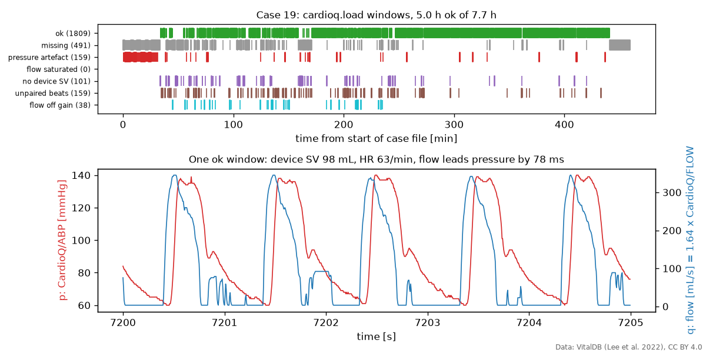
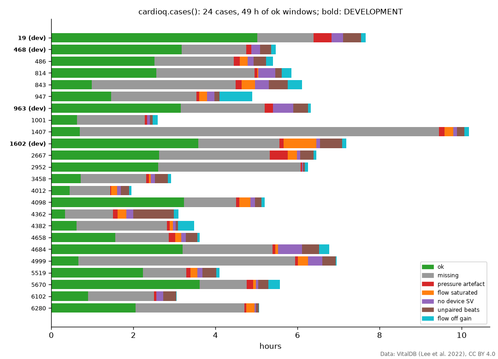
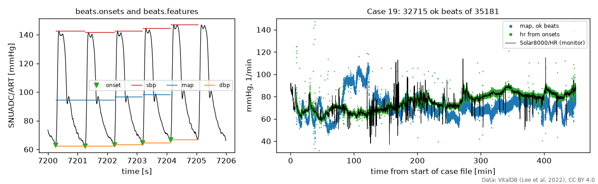

# vitaldb-hemo

Haemodynamic signals from [VitalDB](https://vitaldb.net) and Windkessel model identification in Python. Starter package for the FRTN70 project course at Lund University, autumn 2026.

Work in progress; nothing is released yet. Done so far: `data`, `beats`, `cardioq`, `windkessel` and `identify`.

## Start here: pressure and flow, cleaned

27 VitalDB cases have aortic blood flow from an oesophageal Doppler monitor (CardioQ) next to arterial pressure; 24 of them are usable. `cardioq.load` gives you both on one clock, flow scaled to mL/s, and a table of 10 s windows saying which ones are usable and, if not, why.

```python
from vitaldb_hemo import cardioq

cardioq.cases()  # the 24 usable cases; cardioq.EXCLUDED says why the other 3 are not
cardioq.DEVELOPMENT  # [19, 468, 963, 1602]: tune on these, evaluate on the rest
c = cardioq.load(19)  # downloads the case on first use (about 45 MB)
ok = c.windows[c.windows.ok]  # t0, t1, beats, map, hr, sv, delay, ratio, reason
t, p, q = c.segment(ok.t0.iloc[0], ok.t1.iloc[0])  # s, mmHg, mL/s
```





How the case is cleaned:

- **Pressure is CardioQ/ABP**, the arterial-line signal relayed through the CardioQ monitor at 180 Hz, because it shares a clock with the flow: flow leads it by 40-120 ms of pulse transit, depending on the patient and steady within a case. The original SNUADC/ART (500 Hz) drifts against the CardioQ clock by several hundred milliseconds within minutes, so never pair it with CardioQ/FLOW.
- **Flow in mL/s.** CardioQ/FLOW is a Doppler velocity in device units. It is scaled once per case so that mean flow matches the monitor's own stroke volume times heart rate. The window column `ratio` shows how well that one scale fits each window: typically within 10 %, though in some cases it drifts by up to 20 % over hours.
- **Windows are rejected** for missing samples, pressure artefacts (below), flow at its ceiling (probe not yet placed), no valid stroke volume from the monitor, pressure beats without a matching flow beat, and flow out of proportion to the monitor's stroke volume (probe out of focus).

## Beats

```python
from vitaldb_hemo import beats

on = beats.onsets(c.p, c.fs)  # Zong et al. 2003, sample indices
f = beats.features(c.p, c.fs, on)  # t, sbp, dbp, map, pp, hr, dpdt_max, ok
```



## Windkessel models and fitting

`windkessel` has the 2-, 3- and 4-element models from aortic flow to pressure, and `identify` fits them by output error: it simulates pressure from the measured flow and minimises the squared difference to the measured pressure. Both depend on numpy and scipy only.

```python
from vitaldb_hemo import identify, windkessel

h, k = 1 / c.fs, round(ok.delay.iloc[0] * c.fs)  # delay from flow to pressure, in samples
q, p = q[: len(q) - k], p[k:]  # undo the pulse transit
f = identify.identify([1.0, 1.5, 0.05], q, p, h, model=windkessel.wk3)  # theta = [Rp, C, Rc]
f.theta, f.x0, f.mse  # mmHg s/mL, mL/mmHg, mmHg s/mL; initial state; mmHg^2
p_model = windkessel.simulate(f.theta, f.x0, q, h, model=windkessel.wk3)
```

Without the shift, the fit error roughly doubles. The models describe aortic pressure from total aortic flow; VitalDB gives radial pressure and descending-aortic flow, so the fitted values are not the textbook ones (C ranges from 0.6 to 13 mL/mmHg between windows and cases, against 1-2 for an aortic beat).

`identify.identify` is a local Gauss-Newton fit (`scipy.optimize.least_squares`) that keeps parameters positive; `identify.identify_global` uses the Nelder-Mead simplex, which is slower but forgives a poor start. `free=[1, 1, 0]` holds a parameter fixed, and `x0="periodic"` assumes whole beats. The models and fitter are ported from the Julia package [windkessel-id](https://github.com/hpigot/windkessel-id) and tested against its reference outputs.

## Raw data and artefacts

```python
from vitaldb_hemo import data

names = sorted(data.tracks())  # all 196 track names, e.g. "CardioQ/FLOW"
cases = data.find_cases(["CardioQ/FLOW", "CardioQ/SV", "SNUADC/ART"])  # 27 cases
art, fs = data.load_wave(19, "SNUADC/ART")  # 500 Hz, NaN where missing
t, sv = data.load_numeric(19, "CardioQ/SV")  # one value per beat
art125 = data.resample(art, fs, 125)  # anti-aliased
flags = data.artefact_flags(art, fs)  # dict of boolean masks
```

Case files are cached in `~/.cache/vitaldb-hemo`, or in the folder named by the `VITALDB_HEMO_CACHE` environment variable.


A whole case: the arterial line is zeroed at the start and end, flushed a few times, and occluded by the blood-pressure cuff once an hour. The CardioQ probe is placed about 30 minutes in.


The cuff is easy to miss: the arterial-line pressure decays for about 20 s with no pulse, while the aortic flow keeps beating as before.


`docs/make_figures.py` regenerates these figures.

## Data licence and attribution

No VitalDB data is included in this repository. Case files are downloaded on demand from vitaldb.net, cached locally and read with the [`vitaldb`](https://pypi.org/project/vitaldb/) package. Downloading means accepting the VitalDB data use agreement, which forbids attempts to re-identify patients. VitalDB is licensed under [CC BY 4.0](https://creativecommons.org/licenses/by/4.0/); cite

> Lee HC, Park Y, Yoon SB, Yang SM, Park D, Jung CW. VitalDB, a high-fidelity multi-parameter vital signs database in surgical patients. *Sci Data* 9, 279 (2022). https://doi.org/10.1038/s41597-022-01411-5

This project is not affiliated with or endorsed by the VitalDB team.

The Windkessel models and the batch fitter are ported from the Julia package [windkessel-id](https://github.com/hpigot/windkessel-id).

## AI assistance

Parts of the code and documentation were written with AI assistance. The authors reviewed all AI-assisted contributions and take responsibility for the content of this repository.

Assisted-by: Anthropic Claude

## License

BSD-3-Clause, see [LICENSE](LICENSE).
