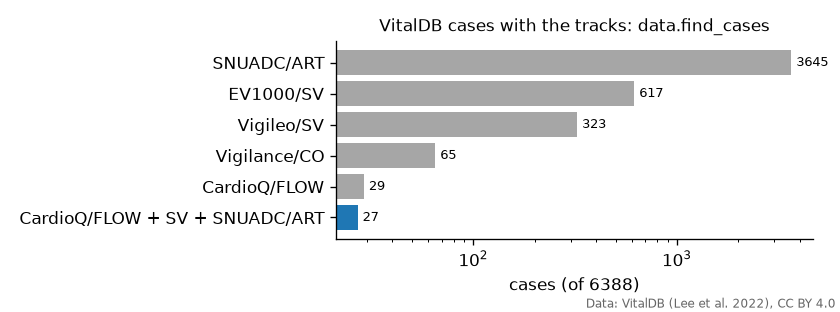
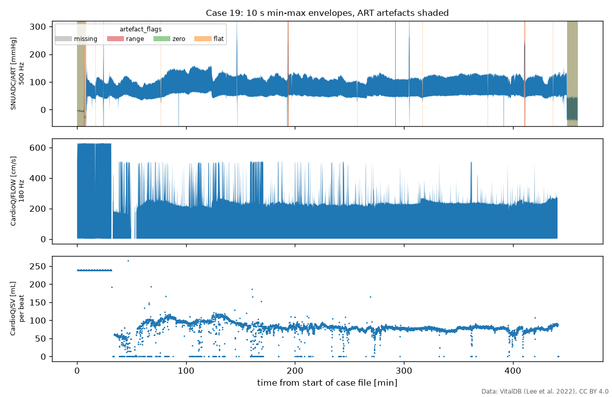
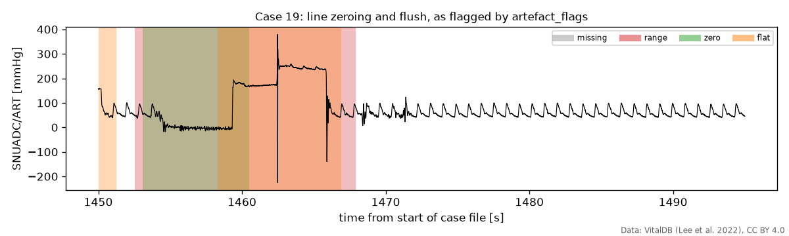
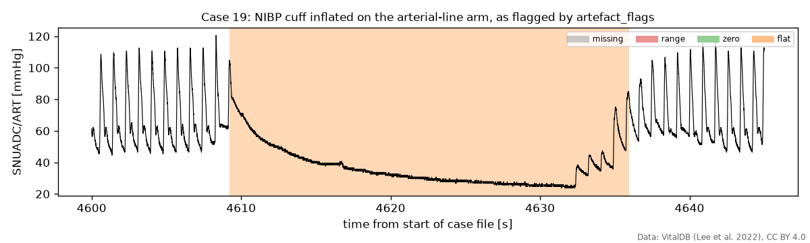

# vitaldb-hemo

Haemodynamic signals from [VitalDB](https://vitaldb.net) and Windkessel model identification in Python. Starter package for the FRTN70 project course at Lund University, autumn 2026.

Work in progress; nothing is released yet. Done so far: the `data` module.

## Getting the data

```python
from vitaldb_hemo import data

names = sorted(data.tracks())  # all 196 track names, e.g. "CardioQ/FLOW"
cases = data.find_cases(["CardioQ/FLOW", "CardioQ/SV", "SNUADC/ART"])  # 27 cases
art, fs = data.load_wave(19, "SNUADC/ART")  # 500 Hz, NaN where missing
flow, fs_flow = data.load_wave(19, "CardioQ/FLOW")  # 180 Hz, same clock
t, sv = data.load_numeric(19, "CardioQ/SV")  # one value per beat
art125 = data.resample(art, fs, 125)  # anti-aliased
flags = data.artefact_flags(art, fs)  # dict of boolean masks
```

Case files (about 45 MB each) are downloaded on first use and cached in `~/.cache/vitaldb-hemo`, or in the folder named by the `VITALDB_HEMO_CACHE` environment variable.



A whole case: the arterial line is zeroed at the start and end, flushed a few times, and occluded by the blood-pressure cuff once an hour. The oesophageal Doppler probe (CardioQ) is placed about 30 minutes in.





The cuff is easy to miss: the arterial-line pressure decays for about 20 s with no pulse, while the aortic flow keeps beating as before. Exclude these stretches before fitting a model to pressure and flow.



`docs/make_figures.py` regenerates these figures.

## Data licence and attribution

No VitalDB data is included in this repository. Case files are downloaded on demand from vitaldb.net, cached locally and read with the [`vitaldb`](https://pypi.org/project/vitaldb/) package. Downloading means accepting the VitalDB data use agreement, which forbids attempts to re-identify patients. VitalDB is licensed under [CC BY 4.0](https://creativecommons.org/licenses/by/4.0/); cite

> Lee HC, Park Y, Yoon SB, Yang SM, Park D, Jung CW. VitalDB, a high-fidelity multi-parameter vital signs database in surgical patients. *Sci Data* 9, 279 (2022). https://doi.org/10.1038/s41597-022-01411-5

This project is not affiliated with or endorsed by the VitalDB team.

The Windkessel models and the batch fitter are ported from the Julia package [windkessel-id](https://github.com/hpigot/windkessel-id).

## AI assistance

Parts of the code and documentation were written with AI assistance. The authors reviewed all AI-assisted contributions and take responsibility for the content of this repository.

Assisted-by: Anthropic Claude

## License

BSD-3-Clause, see [LICENSE](LICENSE).
