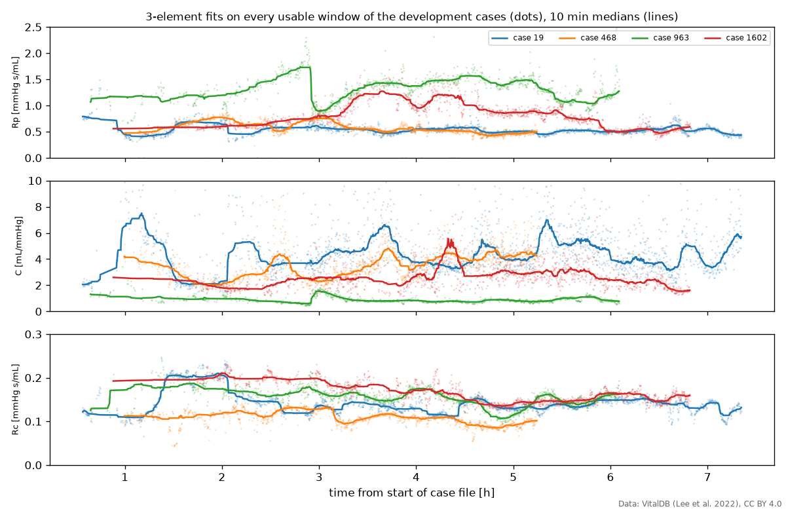
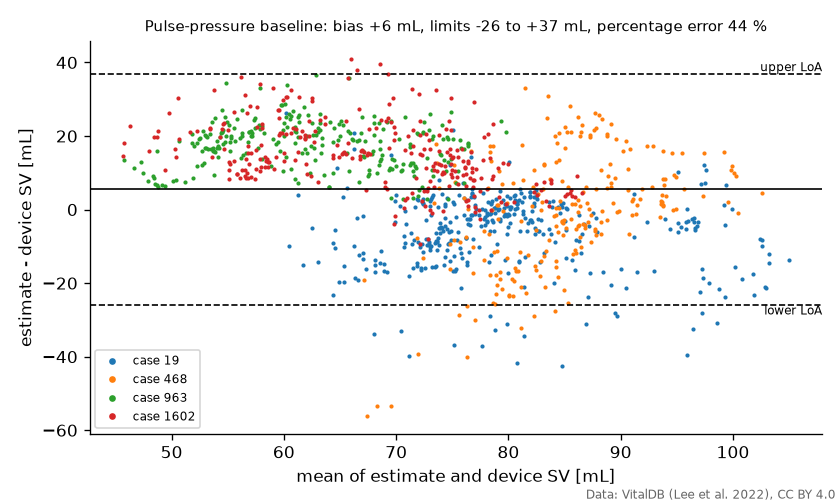

# vitaldb-hemo

Arterial pressure and aortic blood flow from surgical patients in [VitalDB](https://vitaldb.net), cleaned for modelling, together with Windkessel models of the circulation and a fitter for them. Use it as a starting point if you want to model haemodynamics with real patient data, for example to estimate stroke volume or track changes in vascular resistance during surgery.

It was first written for the course FRTN70 Project in Systems, Control and Learning at Lund University in autumn 2026, where student groups use it to build and test model-based estimators of stroke volume.

## Install

Python 3.10 or later:

```sh
pip install git+https://github.com/hpigot/vitaldb-hemo
```

The data is not in the package. Each case is downloaded from VitalDB the first time you load it (about 45 MB) and kept in `~/.cache/vitaldb-hemo`, or in the folder named by the environment variable `VITALDB_HEMO_CACHE`.

## The signals

The package works with two signals recorded at the same time during surgery, and the monitor's own estimates that come with them.

| Term | What it is |
|---|---|
| pressure `p` [mmHg] | Arterial blood pressure from a catheter in an artery, usually the radial artery at the wrist. |
| flow `q` [mL/s] | Blood flow in the descending aorta, from a Doppler probe placed in the oesophagus (the CardioQ monitor). The probe measures blood velocity; the package scales it to flow. |
| device SV, HR | The CardioQ monitor's own stroke volume [mL] and heart rate [1/min], beat by beat. These are the reference values you compare your estimates with. |
| delay [s] | The time from the start of a beat in the flow to the start of the same beat in the pressure: the pulse has to travel from the descending aorta to the wrist (pulse transit), plus any processing lag in the monitors. 40-120 ms, steady within a case. |
| case | One surgery, recorded as one file of several hours. |
| track | One signal in a case, named device/signal, e.g. `CardioQ/FLOW`. |
| window | A 10 s piece of a case, the unit that is judged usable or not. |

27 VitalDB cases have both CardioQ flow and arterial pressure; 24 of them are usable.

## Quickstart

Each step uses the variables from the one before.

### 1. Load a case and pick usable windows

```python
from vitaldb_hemo import cardioq

cardioq.cases()  # the 24 usable cases
cardioq.DEVELOPMENT  # [19, 468, 963, 1602]: develop your methods on these, evaluate on the rest
c = cardioq.load(19)  # c.p, c.q (whole case), c.fs = 180 Hz, c.windows
w = c.windows[c.windows.ok]  # usable windows only, as a pandas DataFrame
t, p, q = c.segment(w.t0.iloc[0], w.t1.iloc[0])  # time [s], pressure, flow of the first one
```


`c.windows` has one row per window:

| Column | Meaning |
|---|---|
| `t0`, `t1` | Start and end of the window [s from the start of the case]. |
| `beats` | Number of beats in the pressure. |
| `map` | Mean arterial pressure [mmHg]. |
| `hr`, `sv` | Device heart rate [1/min] and stroke volume [mL], averaged over the window. |
| `delay` | Median delay from flow to pressure [s], accurate to about 20 ms. |
| `ratio` | How well the case's flow scale fits this window (1 is perfect; see below). |
| `ok`, `reason` | Whether the window is usable, and if not, the first check it failed. |

The reasons a window is rejected:

| `reason` | What happened |
|---|---|
| `missing` | Samples missing in the pressure or the flow. |
| `pressure` | A pressure artefact: the line was flushed or zeroed, or the blood-pressure cuff was inflated on the same arm (see [Raw tracks and artefacts](#raw-tracks-and-artefacts)). |
| `saturated` | The flow signal is stuck at its maximum. This is typical of the first 30-100 minutes, before the probe is placed. |
| `device` | The monitor gave no valid stroke volume or heart rate. |
| `beats` | A pressure beat with no flow beat 0-250 ms before it. |
| `gain` | The flow is more than 20 % out of proportion to the device stroke volume, typically because the probe has moved. |


The pressure comes from the track `CardioQ/ABP`. This is the arterial-line pressure as passed on through the CardioQ monitor, so it is recorded on the same clock as the flow. The same pressure is also recorded directly, in `SNUADC/ART` at 500 Hz, but on a clock that drifts against the CardioQ's by several hundred milliseconds within minutes. If you pair `SNUADC/ART` with the flow, align the two in every window first; otherwise the drift shows up as a changing delay.

The flow is scaled to mL/s. The probe measures velocity in device units. The monitor turns velocity into stroke volume with an aortic cross-section it estimates from the patient's age, height and weight. The package scales the flow once per case so that, over the usable windows, it matches the device stroke volume times heart rate. The column `ratio` shows how well that one scale fits each window: typically within 10 %, although in some cases it drifts by up to 20 % over hours.

### 2. Find the beats

```python
from vitaldb_hemo import beats

on = beats.onsets(p, c.fs)  # sample index where each beat's upstroke starts
f = beats.features(p, c.fs, on)  # one row per beat
```

Onsets are found with the method of Zong et al. (2003). The features of each beat are its time `t` [s], systolic, diastolic, mean and pulse pressure `sbp`, `dbp`, `map`, `pp` [mmHg], heart rate `hr` [1/min], the steepest slope of the upstroke `dpdt_max` [mmHg/s], and `ok`, which is false for beats with missing samples or an implausible heart rate. `beats.onsets(q, c.fs)` finds the beats in the flow the same way.


### 3. Fit a Windkessel model

A Windkessel model treats the arteries as an electrical circuit driven by the flow: a compliance `C` [mL/mmHg] for the elastic arteries that store blood during each beat, a peripheral resistance `Rp` [mmHg s/mL] for the small vessels it drains through, and in the 3-element model a characteristic resistance `Rc` [mmHg s/mL] for the aorta itself. The 2-element model leaves out `Rc`; the 4-element model adds an inertance `L` [mmHg s^2/mL].

```python
from vitaldb_hemo import identify, windkessel

k = round(w.delay.iloc[0] * c.fs)  # the window's delay, in samples
qs, ps = q[: len(q) - k], p[k:]  # shift the pressure back so the beats line up with the flow
fit = identify.identify([1.0, 1.5, 0.05], qs, ps, 1 / c.fs, model=windkessel.wk3)
fit.theta  # fitted [Rp, C, Rc]
fit.mse  # mean squared error between measured and model pressure [mmHg^2]
p_model = windkessel.simulate(fit.theta, fit.x0, qs, 1 / c.fs, model=windkessel.wk3)
```

The fit simulates the pressure the model produces from the measured flow and adjusts the parameters until it is as close as possible to the measured pressure. It needs a starting guess; `[1.0, 1.5, 0.05]` is in the range of typical adult values. It also estimates `fit.x0`, the volume stored in `C` at the start of the window, which the model cannot know from the flow alone.

Shift by the delay before fitting. The model assumes pressure and flow are measured at the same place, and without the shift the fit error roughly doubles. Even then, the model describes pressure in the aorta, while here pressure is measured at the wrist and flow in the descending aorta only. The fitted values are therefore not the textbook ones: `C` ranges from 0.6 to 13 mL/mmHg between windows and cases, against about 1-2 for a beat measured in the aorta. They are more useful for following one patient over time than for comparing with the literature.



Fitted on every usable window, `Rp` and `Rc` change slowly within a case, while `C` scatters by a factor of 2 to 3 from one window to the next and its 10 min median jumps. A value of `C` taken from a single 10 s window is therefore a poor calibration; take the median over several minutes.

More options:

- `identify.identify_global` uses the Nelder-Mead method. It is slower but copes better with a poor starting guess.
- `free=[1, 1, 0]` keeps a parameter fixed at its starting value.
- `x0="periodic"` assumes the window holds whole beats in a steady state, instead of estimating `x0`.

### 4. Compare with the device

`evaluate` measures how well a stroke volume estimate agrees with the device stroke volume. Two simple baselines show how: stroke volume proportional to pulse pressure, and the Liljestrand-Zander formula, proportional to PP/(SBP + DBP), the best of eight simple pressure formulas compared by [Sun et al. (2009)](https://doi.org/10.1097/CCM.0b013e3181930174). Each has its factor calibrated on the first 5 usable minutes.

```python
import numpy as np

from vitaldb_hemo import evaluate

f = beats.features(c.p, c.fs, beats.onsets(c.p, c.fs))  # beats of the whole case
pp = f[f.ok].groupby(f.t // 10 * 10).pp.mean()  # mean pulse pressure per window, by t0
lz = (f.pp / (f.sbp + f.dbp))[f.ok].groupby(f.t // 10 * 10).mean()  # Liljestrand-Zander: use lz for pp below
est = pp.reindex(w.t0).to_numpy() * np.mean(w.sv[:30] / pp.reindex(w.t0[:30]).to_numpy())
a = evaluate.agreement(est[30:], w.sv[30:])
a.bias, a.loa, a.percentage_error  # mL, mL, %
rate, n = evaluate.concordance(est[30::30], w.sv[30::30])  # direction of 5 min changes
```

`agreement` gives the Bland-Altman bias and 95 % limits of agreement, and the percentage error, 1.96 standard deviations of the difference divided by the mean device value. Monitors of cardiac output are usually held to a percentage error under 30 %. When you pool several cases, pass `subject=` with the case of each value: several values from one patient are not independent, and the limits would otherwise come out too narrow. `concordance` counts how often the estimate changes in the same direction as the device, leaving out changes under 15 %; above 0.9 is the usual criterion.



On the development cases, the pulse-pressure baseline has a percentage error of 23-36 % within single cases, 44 % pooled, and a concordance of 0.74 for 5 min changes. Liljestrand-Zander has 23-29 % within single cases and a concordance of 0.85, but 55 % pooled: the pooled figure also includes how far each patient's calibration is off for the rest of the case, and four patients pin that down poorly. Holding stroke volume constant at its calibration value gives 70 % pooled. These are the numbers a model-based estimate has to beat.

## Raw tracks and artefacts

You need this part only if you want tracks or cases outside the cleaned CardioQ set.

```python
from vitaldb_hemo import data

names = sorted(data.tracks())  # all 196 track names
cases = data.find_cases(["CardioQ/FLOW", "CardioQ/SV", "SNUADC/ART"])  # cases with all of them
art, fs = data.load_wave(19, "SNUADC/ART")  # a waveform at its own rate (500 Hz), NaN where missing
t, sv = data.load_numeric(19, "CardioQ/SV")  # a value recorded once per beat, with its times
art125 = data.resample(art, fs, 125)  # to another rate, filtered so it does not alias
flags = data.artefact_flags(art, fs)  # boolean masks of artefacts, by type
```


Over a whole case, the arterial line is zeroed at the start and end, flushed a few times, and occluded by the blood-pressure cuff once an hour. The CardioQ probe is placed about 30 minutes in.


The cuff inflations are easy to miss. The arterial pressure decays for about 20 s with no pulse, while the aortic flow keeps beating as before.


## Development

```sh
uv run pytest  # tests
uv run python docs/make_figures.py  # regenerate docs/img (downloads the cases it shows)
```

`examples/case19.ipynb` runs one case through the four quickstart steps with plots. It is run by hand, since it downloads data. The main design choices are recorded in [`docs/adr`](docs/adr).

The Windkessel models and the fitter are ported from the Julia package [WindkesselIdentification.jl](https://github.com/hpigot/WindkesselIdentification.jl), and the tests check them against its reference outputs.

## Data licence and attribution

No VitalDB data is included in this repository. Case files are downloaded on demand from vitaldb.net, cached locally and read with the [`vitaldb`](https://pypi.org/project/vitaldb/) package. Downloading means accepting the VitalDB data use agreement, which forbids attempts to re-identify patients. VitalDB is licensed under [CC BY 4.0](https://creativecommons.org/licenses/by/4.0/); cite

> Lee HC, Park Y, Yoon SB, Yang SM, Park D, Jung CW. VitalDB, a high-fidelity multi-parameter vital signs database in surgical patients. *Sci Data* 9, 279 (2022). https://doi.org/10.1038/s41597-022-01411-5

This project is not affiliated with or endorsed by the VitalDB team.

## AI assistance

Parts of the code and documentation were written with AI assistance. The authors reviewed all AI-assisted contributions and take responsibility for the content of this repository.

Assisted-by: Anthropic Claude

## License

BSD-3-Clause, see [LICENSE](LICENSE).
